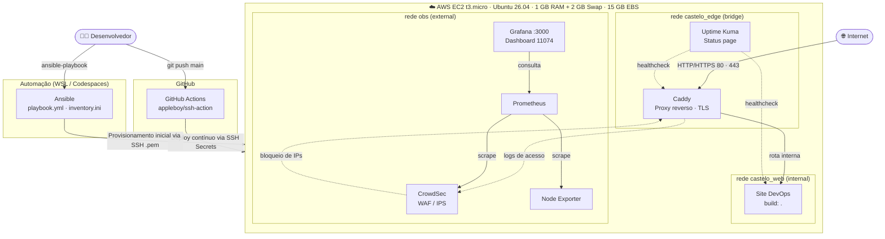
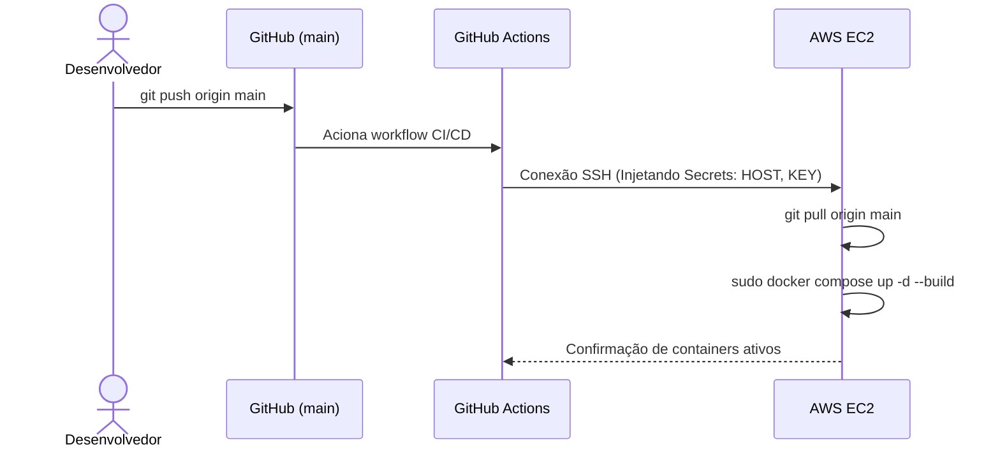
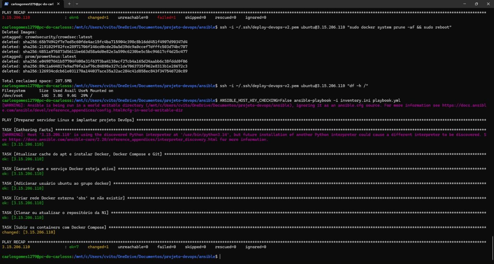
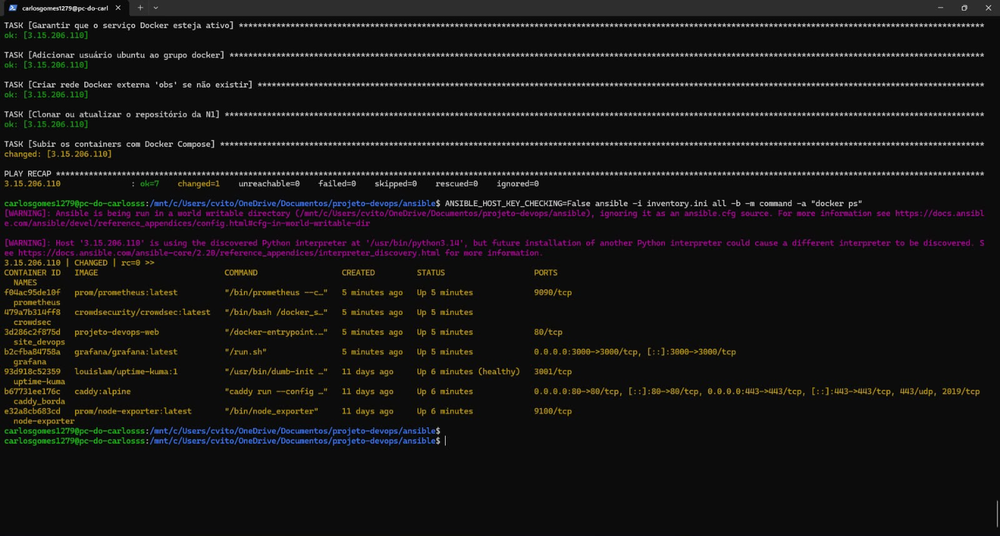
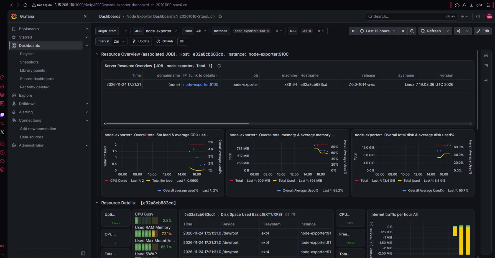
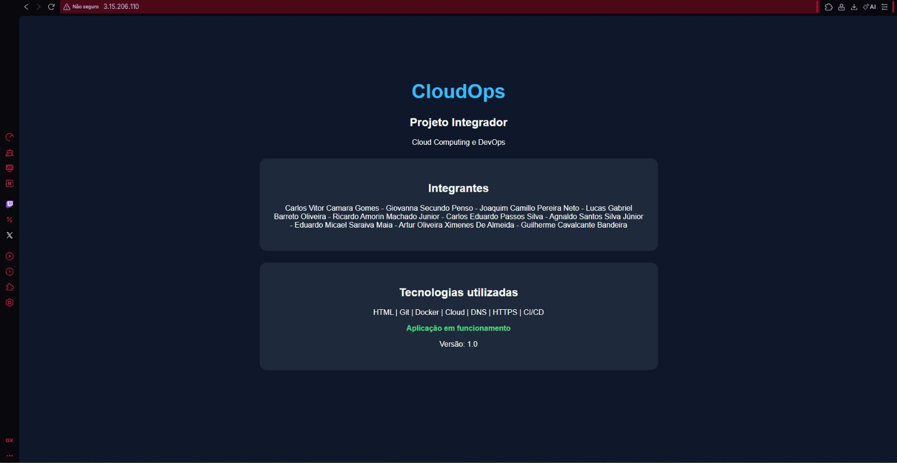

# 🏰 Projeto DevOps — Infraestrutura Cloud, Observabilidade & Automação (Ansible) na AWS

> Infraestrutura self-hosted em uma única instância **AWS EC2 (`t3.micro`)** que entrega uma aplicação web com borda protegida (Proxy Reverso + WAF), observabilidade completa de métricas, monitoramento de disponibilidade, **provisionamento automatizado com Ansible (N2)** e **deploy contínuo via GitHub Actions (N1)**. Tudo orquestrado com Docker Compose dentro do limite de **1 GB de RAM** do Free Tier.


---

## 📋 Informações Acadêmicas e Técnicas

|                   |                                                 |
| :------------------------ | :------------------------------------------------------ |
| **Instituição**           | Centro Universitário Faculdade São Lucas                |
| **Disciplina**            | Devops e Computação em Nuvem                            |
| **Avaliação**             | N1 e N2                                                 |
| **Provedor Cloud**        | AWS EC2 — instância `t3.micro` (Free Tier)              |
| **Sistema Operacional**   | Ubuntu 26.04 LTS                                        |
| **Recursos da Instância** | 2 vCPUs · **1 GB de RAM** (+ 2 GB Swap) · **15 GB EBS** |
| **Provisionamento (IaC)** | Ansible (`ansible/playbook.yml`)                        |
| **Orquestração**          | Docker + Docker Compose (`docker-compose.yml` único)    |
| **Repositório**           | `https://github.com/Buzzidd/projeto-devops`             |

### 👥 Equipe Completa

- Carlos Vitor Camara Gomes
- Giovanna Secundo Penso
- Joaquim Camillo Pereira Neto
- Lucas Gabriel Barreto Oliveira
- Ricardo Amorin Machado Junior
- Carlos Eduardo Passos Silva
- Agnaldo Santos Silva Júnior
- Eduardo Micael Saraiva Maia
- Artur Oliveira Ximenes De Almeida
- Guilherme Cavalcante Bandeira

---

## 📑 Índice

1. [Sobre o projeto](#-1-sobre-o-projeto)
2. [Arquitetura](#-2-arquitetura)
3. [Tecnologias](#-3-tecnologias)
4. [Redes do Docker](#-4-redes-do-docker)
5. [Borda, Segurança e Gestão de Segredos](#-5-borda-segurança-e-gestão-de-segredos)
6. [Observabilidade e Disponibilidade](#-6-observabilidade-e-disponibilidade)
7. [CI/CD: Deploy Automatizado](#-7-cicd-deploy-automatizado)
8. [Automação de Infraestrutura com Ansible (N2)](#-8-automação-de-infraestrutura-com-ansible-n2)
9. [Como subir a infraestrutura manualmente](#-9-como-subir-a-infraestrutura-manualmente)
10. [Limitações e Desafios (Engenharia de Resiliência)](#-10-limitações-e-desafios-engenharia-de-resiliência)

---

## 🎯 1. Sobre o projeto

O projeto consiste em uma arquitetura de infraestrutura que hospeda, monitora, protege e provisiona automaticamente uma aplicação web DevOps. O objetivo foi estruturar, em uma única máquina da AWS, um ambiente reproduzível que aplica padrões reais de produção:

- **Provisionamento Reproduzível (N2):** Um playbook **Ansible** prepara qualquer servidor Ubuntu limpo do zero — instalando dependências, configurando Docker, criando a rede externa, clonando o repositório e subindo os 7 containers de forma idempotente.
- **Borda segura:** Todo o tráfego passa pelo Caddy (portas 80/443), com gerenciamento automático de TLS e mitigação ativa contra IPs maliciosos via CrowdSec.
- **Observabilidade:** Métricas de hardware e sistema (CPU, RAM, disco e rede) extraídas pelo Node Exporter, armazenadas pelo Prometheus e exibidas no Grafana.
- **Disponibilidade:** O Uptime Kuma monitora a saúde dos containers e publica uma página de status.
- **Entrega Contínua (CI/CD):** A cada push na branch `main`, o GitHub Actions realiza o deploy automático via SSH utilizando variáveis injetadas por cofre de segredos.
- **Isolamento de rede:** Três redes Docker separam o tráfego de borda, a comunicação interna da aplicação e a camada de observabilidade.

---

## 🏗️ 2. Arquitetura



**Fluxo resumido:** O **Ansible** prepara o servidor Linux do zero e sobe a stack completa via SSH. Com o ambiente no ar, o tráfego externo entra exclusivamente pelo Caddy, que valida os logs junto ao CrowdSec para bloquear ataques e encaminha requisições legítimas ao container do site. Paralelamente, o Node Exporter coleta métricas do servidor para o Prometheus e Grafana, enquanto atualizações de código no GitHub disparam o deploy automatizado via GitHub Actions sem expor credenciais no código-fonte.

---

## 🧰 3. Tecnologias

| Camada                    | Ferramenta                       | Função                                                            |
| :------------------------ | :------------------------------- | :---------------------------------------------------------------- |
| **Provisionamento (IaC)** | **Ansible**                      | Configuração automatizada e idempotente do servidor Linux via SSH |
| **Nuvem**                 | **AWS EC2** (`t3.micro`)         | Servidor virtual no Free Tier (2 vCPUs, 1 GB RAM, 15 GB EBS)      |
| **Sistema Operacional**   | **Ubuntu 26.04 LTS**             | Sistema base do host                                              |
| **Containers**            | **Docker + Docker Compose**      | Empacotamento e orquestração de múltiplos serviços                |
| **Borda / Proxy Reverso** | **Caddy**                        | Roteamento HTTP/HTTPS e geração de logs estruturados              |
| **WAF / IPS**             | **CrowdSec**                     | Análise de logs e bloqueio de ataques na camada de borda          |
| **Coleta de Métricas**    | **Prometheus**                   | Banco de dados de séries temporais (TSDB) para métricas           |
| **Métricas do Host**      | **Node Exporter**                | Extração de indicadores de hardware e kernel do host Linux        |
| **Dashboards**            | **Grafana** (porta `3000`)       | Visualização gráfica utilizando o dashboard ID **`11074`**        |
| **Disponibilidade**       | **Uptime Kuma**                  | Monitoramento contínuo de uptime dos serviços                     |
| **Aplicação Web**         | **NGINX Alpine (`Site DevOps`)** | Servidor web leve construído via `Dockerfile` local               |
| **CI/CD**                 | **GitHub Actions**               | Automação da esteira de deploy via SSH                            |

---

## 🔌 4. Redes do Docker

A arquitetura aplica o princípio de privilégio mínimo na camada de rede:

| Rede           | Tipo       | Serviços Conectados                                  | Propósito                                                                                        |
| :------------- | :--------- | :--------------------------------------------------- | :----------------------------------------------------------------------------------------------- |
| `castelo_web`  | `internal` | Site, Caddy e Uptime Kuma                            | **Isolamento total:** Sem rota direta para a internet externa. Protege o container da aplicação. |
| `castelo_edge` | `bridge`   | Caddy e Uptime Kuma                                  | **Camada de borda:** Único ponto de contato com o tráfego externo.                               |
| `obs`          | `external` | Caddy, CrowdSec, Prometheus, Grafana e Node Exporter | **Observabilidade e Segurança:** Tráfego isolado para coleta de telemetria e análise de logs.    |

---

## 🛡️ 5. Borda, Segurança e Gestão de Segredos

### 🚪 Caddy & CrowdSec (Defesa em Profundidade)

- O **Caddy** centraliza a entrada nas portas **80 e 443**, ocultando os demais containers.
- O **CrowdSec** lê continuamente os logs gerados pelo Caddy para detectar padrões de ataque (força bruta, port scanning, exploits) e aplicar bloqueios preventivos.

### 🔒 Hardening e Sigilo de Credenciais

Para evitar exposição de dados sensíveis e chaves de infraestrutura em repositórios públicos:

- **Proteção via `.gitignore`:** Chaves privadas SSH (`*.pem`) e arquivos de variáveis locais (`.env`) são bloqueados no versionamento local antes de qualquer commit.
- **Injeção Segura no CI/CD:** A autenticação entre o GitHub e a AWS utiliza exclusivamente o cofre criptografado do **GitHub Actions Secrets**.
- **Auto-recuperação:** Todos os serviços operam com políticas `restart: always` ou `unless-stopped`.

---

## 📊 6. Observabilidade e Disponibilidade

### 📈 Pipeline de Métricas

1. **Node Exporter:** Coleta o uso de CPU, memória RAM e I/O de disco do host.
2. **Prometheus:** Realiza o _scrape_ periódico das métricas.
3. **Grafana:** Consome os dados do Prometheus e os apresenta no dashboard comunitário **ID `11074`** (_Node Exporter Full_).

> 💡 **Configuração do Painel:** No Grafana (`http://<SEU_IP_PUBLICO>:3000`), acesse _Dashboards → New → Import_, insira o ID `11074` e selecione a fonte de dados do Prometheus.

### ✅ Monitoramento de Uptime

O **Uptime Kuma** verifica internamente a resposta do container web e do proxy reverso, oferecendo uma interface visual de disponibilidade em tempo real.

---

## 🚀 7. CI/CD: Deploy Automatizado

O pipeline em `.github/workflows/deploy.yml` é acionado automaticamente a cada `push` na branch `main`, conectando-se à instância EC2 via SSH para atualizar os containers.

### 🔐 Variáveis de Ambiente e Secrets

Configurados de forma privada no repositório (_Settings → Secrets and variables → Actions_):

| Secret     | Descrição                                                    |
| :--------- | :----------------------------------------------------------- |
| `HOST`     | Endereço IP público ou DNS da instância EC2                  |
| `USERNAME` | Usuário padrão da instância Linux (ex.: `ubuntu`)            |
| `KEY`      | Conteúdo da chave privada SSH (`.pem`) exclusiva para deploy |
| `PORT`     | Porta de conexão SSH (padrão: `22`)                          |

### 🔄 Fluxo da Esteira



### 📄 Estrutura do Workflow (`.github/workflows/deploy.yml`)

```yaml
name: Deploy

on:
  push:
    branches: [main]

jobs:
  deploy:
    runs-on: ubuntu-latest
    steps:
      - name: Deploy via SSH na AWS
        uses: appleboy/ssh-action@v1.0.3
        with:
          host: ${{ secrets.HOST }}
          username: ${{ secrets.USERNAME }}
          key: ${{ secrets.KEY }}
          port: ${{ secrets.PORT }}
          script: |
            cd ~/projeto-devops
            git pull origin main
            sudo docker compose up -d --build
```

---

## 🤖 8. Automação de Infraestrutura com Ansible (N2)

Para eliminar a configuração manual da instância EC2 e garantir que toda a infraestrutura possa ser recriada em qualquer servidor Ubuntu zerado, foi adicionada a camada de automação na pasta `ansible/`.

### 📁 Estrutura da Pasta `ansible/`

| Arquivo         | Função                                                                 |
| :-------------- | :--------------------------------------------------------------------- |
| `ansible.cfg`   | Configurações padrão do Ansible (inventário e desativação de host key) |
| `inventory.ini` | Define o IP público do servidor alvo, usuário SSH e caminho da `.pem`  |
| `playbook.yml`  | Roteiro declarativo que provisiona o servidor e sobe toda a stack      |

### ⚙️ Tarefas Automatizadas pelo `playbook.yml`

1. Atualização do cache `apt` e instalação do **Docker**, **Docker Compose** e **Git**.
2. Garantia de que o serviço `docker` esteja ativo e habilitado no boot.
3. Inclusão do usuário `ubuntu` no grupo `docker`.
4. Criação idempotente da rede externa `obs` (se ainda não existir).
5. Clonagem ou atualização automática do repositório `projeto-devops` na instância.
6. Build e inicialização dos 7 containers com `docker compose up -d --build`.

### 📋 Pré-requisitos da Instância Alvo

- **Instância AWS EC2 (Ubuntu)** com no mínimo **15 GiB** de volume EBS (o padrão de 8 GiB esgota durante a extração de imagens como Grafana e Prometheus).
- **Security Group** com regras de entrada liberando as portas: `22` (SSH), `80` (HTTP), `443` (HTTPS) e `3000` (Grafana) para `0.0.0.0/0`.
- **Máquina de controle:** Linux, **WSL (Ubuntu no Windows)** ou **GitHub Codespaces** com Ansible instalado (`sudo apt update && sudo apt install ansible -y`).

### ▶️ Passo a Passo de Execução

```bash
# 1. Mover a chave privada SSH e restringir permissões
chmod 400 ~/.ssh/deploy-devops-v2.pem

# 2. Entrar na pasta do Ansible (ajuste o IP e a chave no inventory.ini se necessário)
cd ansible

# 3. Testar a comunicação SSH do Ansible com a instância EC2
ANSIBLE_HOST_KEY_CHECKING=False ansible -i inventory.ini all -m ping

# 4. Executar o playbook de provisionamento e deploy completo
ANSIBLE_HOST_KEY_CHECKING=False ansible-playbook -i inventory.ini playbook.yml

# 5. Validar remotamente os 7 containers em execução
ANSIBLE_HOST_KEY_CHECKING=False ansible -i inventory.ini all -b -m command -a "docker ps"
```

> 💡 **Dica para demonstração em sala (GitHub Codespaces):** Caso o computador não tenha WSL configurado ou a rede local bloqueie a porta `22`, abra o repositório no **GitHub Codespaces**, instale o Ansible no terminal Linux do navegador, carregue a chave `.pem` temporariamente (sem fazer commit) e execute os mesmos comandos acima.

### ✅ Verificação de Acesso

- **Aplicação Principal:** `http://<SEU_IP_PUBLICO>`
- **Painel Grafana:** `http://<SEU_IP_PUBLICO>:3000`
- **Servidor atual da demonstração:** `http://3.15.206.110` (Grafana em `http://3.15.206.110:3000`)

### 📸 Evidências da Execução (N2)

Execução real do playbook em 24/11/2026, no servidor `3.15.206.110`. Os prints ficam na pasta [`evidencias/`](evidencias/).

| # | O que mostra | Print |
| :- | :----------- | :---- |
| 1 | `ansible-playbook` concluído: **PLAY RECAP** com `ok=7 changed=1 unreachable=0 failed=0` | [1-playbook-executado.jpeg](evidencias/1-playbook-executado.jpeg) |
| 2 | `docker ps` rodado pelo Ansible: os **7 containers** com status `Up` | [2-docker-ps-7-containers.jpeg](evidencias/2-docker-ps-7-containers.jpeg) |
| 3 | **Grafana** na porta `3000` com o dashboard **11074** (Node Exporter) | [3-grafana-porta-3000.jpeg](evidencias/3-grafana-porta-3000.jpeg) |
| 4 | **Aplicação no ar** por HTTP em `http://3.15.206.110` | [4-site-no-ar.jpeg](evidencias/4-site-no-ar.jpeg) |






---

## ▶️ 9. Como subir a infraestrutura manualmente

Caso seja necessário subir a aplicação diretamente dentro do servidor sem utilizar o Ansible:

```bash
# 1. Clonar o repositório na instância EC2
git clone [https://github.com/Buzzidd/projeto-devops.git](https://github.com/Buzzidd/projeto-devops.git)
cd projeto-devops

# 2. Criar a rede externa de observabilidade
sudo docker network create obs

# 3. Construir e iniciar os containers em background
sudo docker compose up -d --build

# 4. Validar o status de execução dos 7 containers
sudo docker compose ps

# 5. Monitorar o consumo de RAM e disco do host
free -h
df -h /
sudo docker stats --no-stream
```

---

## ⚠️ 10. Limitações e Desafios (Engenharia de Resiliência)

### 🧠 Gargalo de 1 GB de RAM durante o CI/CD e Execução Simultânea

A instância `t3.micro` possui apenas **1 GB de RAM**. Embora suporte os 7 containers em execução normal, o comando `docker compose up -d --build` disparado pelo GitHub Actions ou pelo Ansible exige compilação de imagem simultânea aos serviços ativos, gerando picos de consumo que esgotam a memória física e causam travamentos (_Run Command Timeout_ / _Connection timed out_).

### 💾 Limite do Disco Padrão de 8 GiB na AWS

Durante a execução do playbook em disco padrão de 8 GiB, a extração simultânea das camadas das imagens do **Grafana**, **Prometheus**, **CrowdSec**, **Uptime Kuma** e **Caddy** levou o volume raiz (`/dev/root`) a **100% de ocupação** (`no space left on device`), interrompendo o deploy e até conexões Ansible.

### 🛠️ Mitigações Aplicadas

1. **Expansão do Volume EBS para 15 GiB:** Aumento do disco da instância de 8 GiB para **15 GiB** (mantendo-se dentro do limite gratuito de 30 GiB do Free Tier) combinado com limpeza de cache (`docker system prune -af`), reduzindo a ocupação do disco para menos de 30%.
2. **Alocação de 2 GB de Memória SWAP:** Criação de um arquivo de SWAP permanente em disco para absorver picos de consumo durante builds e evitar o congelamento da máquina:

```bash
sudo fallocate -l 2G /swapfile
sudo chmod 600 /swapfile
sudo mkswap /swapfile
sudo swapon /swapfile
echo '/swapfile none swap sw 0 0' | sudo tee -a /etc/fstab
```

3. **Políticas de Restart:** Graças ao parâmetro `restart: always` / `unless-stopped`, após qualquer reinício da instância pelo console da AWS, o Docker daemon restaura todos os 7 containers automaticamente sem intervenção manual.

---

<div align="center">

🏰 **Projeto DevOps** · Cloud Computing · Centro Universitário Faculdade São Lucas  
Desenvolvido por **Carlos Vitor Camara Gomes**, e equipe.

</div>
