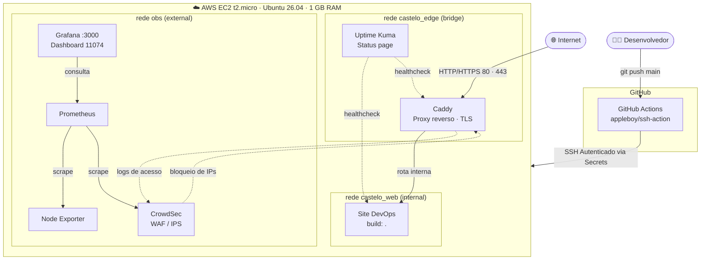
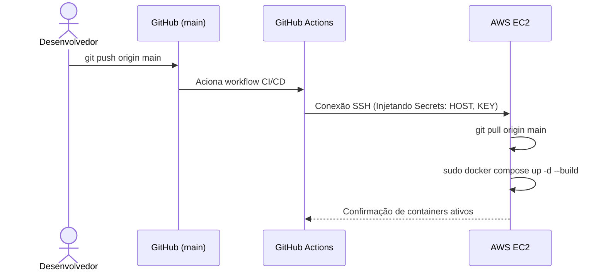

# 🏰 Projeto DevOps — Infraestrutura Cloud & Observabilidade na AWS

> Infraestrutura self-hosted em uma única instância **AWS EC2 (`t2.micro`)** que entrega uma aplicação web com borda protegida (Proxy Reverso + WAF), observabilidade completa de métricas, monitoramento de disponibilidade e **deploy automatizado via GitHub Actions**. Tudo orquestrado com Docker Compose, rodando dentro do limite de **1 GB de RAM** do Free Tier.


---

## 📋 Informações Acadêmicas e Técnicas

| Item                      | Valor                                                |
| :------------------------ | :--------------------------------------------------- |
| **Alunos responsáveis**   | Carlos Vitor Camara Gomes e Giovanna Secundo Penso   |
| **Instituição**           | Centro Universitário Faculdade São Lucas             |
| **Disciplina**            | Cloud Computing                                      |
| **Avaliação**             | N1                                                   |
| **Provedor Cloud**        | AWS EC2 — instância `t2.micro` (Free Tier)           |
| **Sistema Operacional**   | Ubuntu 26.04 LTS                                     |
| **Recursos da Instância** | 1 vCPU · **1 GB de RAM**                             |
| **Orquestração**          | Docker + Docker Compose (`docker-compose.yml` único) |
| **Repositório**           | `https://github.com/Buzzidd/projeto-devops`          |

### 👥 Equipe Completa

- Carlos Vitor Camara Gomes
- Giovanna Secundo Penso
- Joaquim Camillo Pereira Neto
- Lucas Gabriel Barreto Oliveira
- Ricardo Amorin Machado Junior
- Carlos Eduardo Passos Silva
- Agnaldo Santos Silva Júnior
- Eduardo Micael Saraiva Maia
- Artur Oliveira Ximenes De Almeida
- Guilherme Cavalcante Bandeira

---

## 📑 Índice

1. [Sobre o projeto](#-1-sobre-o-projeto)
2. [Arquitetura](#-2-arquitetura)
3. [Tecnologias](#-3-tecnologias)
4. [Redes do Docker](#-4-redes-do-docker)
5. [Borda, Segurança e Gestão de Segredos](#-5-borda-segurança-e-gestão-de-segredos)
6. [Observabilidade e Disponibilidade](#-6-observabilidade-e-disponibilidade)
7. [CI/CD: Deploy Automatizado](#-7-cicd-deploy-automatizado)
8. [Como subir a infraestrutura](#-8-como-subir-a-infraestrutura)
9. [Limitações e Desafios (Engenharia de Resiliência)](#-9-limitações-e-desafios-engenharia-de-resiliência)

---

## 🎯 1. Sobre o projeto

O projeto consiste em uma arquitetura de infraestrutura que hospeda, monitora e protege uma aplicação web DevOps. O objetivo foi estruturar, em uma única máquina da AWS, um ambiente que aplica padrões reais de produção:

- **Borda segura:** Todo o tráfego passa pelo Caddy (portas 80/443), com gerenciamento automático de TLS e mitigação ativa contra IPs maliciosos via CrowdSec.
- **Observabilidade:** Métricas de hardware e sistema (CPU, RAM, disco e rede) extraídas pelo Node Exporter, armazenadas pelo Prometheus e exibidas no Grafana.
- **Disponibilidade:** O Uptime Kuma monitora a saúde dos containers e publica uma página de status.
- **Entrega Contínua (CI/CD):** A cada push na branch `main`, o GitHub Actions realiza o deploy automático via SSH utilizando variáveis injetadas por cofre de segredos.
- **Isolamento de rede:** Três redes Docker separam o tráfego de borda, a comunicação interna da aplicação e a camada de observabilidade.

---

## 🏗️ 2. Arquitetura



**Fluxo resumido:** O tráfego externo entra exclusivamente pelo Caddy, que valida os logs junto ao CrowdSec para bloquear ataques e encaminha requisições legítimas ao container do site. Paralelamente, o Node Exporter coleta métricas do servidor para o Prometheus e Grafana, enquanto atualizações de código no GitHub disparam o deploy automatizado via SSH sem expor credenciais no código-fonte.

---

## 🧰 3. Tecnologias

| Camada                    | Ferramenta                       | Função                                                     |
| :------------------------ | :------------------------------- | :--------------------------------------------------------- |
| **Nuvem**                 | **AWS EC2** (`t2.micro`)         | Servidor virtual no Free Tier (1 vCPU, 1 GB RAM)           |
| **Sistema Operacional**   | **Ubuntu 26.04 LTS**             | Sistema base do host                                       |
| **Containers**            | **Docker + Docker Compose**      | Empacotamento e orquestração de múltiplos serviços         |
| **Borda / Proxy Reverso** | **Caddy**                        | Roteamento HTTP/HTTPS e geração de logs estruturados       |
| **WAF / IPS**             | **CrowdSec**                     | Análise de logs e bloqueio de ataques na camada de borda   |
| **Coleta de Métricas**    | **Prometheus**                   | Banco de dados de séries temporais (TSDB) para métricas    |
| **Métricas do Host**      | **Node Exporter**                | Extração de indicadores de hardware e kernel do host Linux |
| **Dashboards**            | **Grafana** (porta `3000`)       | Visualização gráfica utilizando o dashboard ID **`11074`** |
| **Disponibilidade**       | **Uptime Kuma**                  | Monitoramento contínuo de uptime dos serviços              |
| **Aplicação Web**         | **NGINX Alpine (`Site DevOps`)** | Servidor web leve construído via `Dockerfile` local        |
| **CI/CD**                 | **GitHub Actions**               | Automação da esteira de deploy via SSH                     |

---

## 🔌 4. Redes do Docker

A arquitetura aplica o princípio de privilégio mínimo na camada de rede:

| Rede           | Tipo       | Serviços Conectados                                  | Propósito                                                                                        |
| :------------- | :--------- | :--------------------------------------------------- | :----------------------------------------------------------------------------------------------- |
| `castelo_web`  | `internal` | Site, Caddy e Uptime Kuma                            | **Isolamento total:** Sem rota direta para a internet externa. Protege o container da aplicação. |
| `castelo_edge` | `bridge`   | Caddy e Uptime Kuma                                  | **Camada de borda:** Único ponto de contato com o tráfego externo.                               |
| `obs`          | `external` | Caddy, CrowdSec, Prometheus, Grafana e Node Exporter | **Observabilidade e Segurança:** Tráfego isolado para coleta de telemetria e análise de logs.    |

---

## 🛡️ 5. Borda, Segurança e Gestão de Segredos

### 🚪 Caddy & CrowdSec (Defesa em Profundidade)

- O **Caddy** centraliza a entrada nas portas **80 e 443**, ocultando os demais containers.
- O **CrowdSec** lê continuamente os logs gerados pelo Caddy para detectar padrões de ataque (força bruta, port scanning, exploits) e aplicar bloqueios preventivos.

### 🔒 Hardening e Sigilo de Credenciais

Para evitar exposição de dados sensíveis e chaves de infraestrutura em repositórios públicos:

- **Desacoplamento de IP e Credenciais:** Nenhum endereço IP público, senha ou chave criptográfica é declarado de forma estática (_hardcoded_) nos arquivos do repositório.
- **Proteção via `.gitignore`:** Chaves privadas SSH (`*.pem`, `*.key`) e arquivos de variáveis locais (`.env`) são bloqueados no versionamento local antes de qualquer commit.
- **Injeção Segura no CI/CD:** A autenticação entre o GitHub e a AWS utiliza exclusivamente o cofre criptografado do **GitHub Actions Secrets**.
- **Auto-recuperação:** Todos os serviços operam com políticas `restart: always` ou `unless-stopped`.

---

## 📊 6. Observabilidade e Disponibilidade

### 📈 Pipeline de Métricas

1. **Node Exporter:** Coleta o uso de CPU, memória RAM e I/O de disco do host.
2. **Prometheus:** Realiza o _scrape_ periódico das métricas.
3. **Grafana:** Consome os dados do Prometheus e os apresenta no dashboard comunitário **ID `11074`** (_Node Exporter Full_).

> 💡 **Configuração do Painel:** No Grafana (`http://<SEU_IP_PUBLICO>:3000`), acesse _Dashboards → New → Import_, insira o ID `11074` e selecione a fonte de dados do Prometheus.

### ✅ Monitoramento de Uptime

O **Uptime Kuma** verifica internamente a resposta do container web e do proxy reverso, oferecendo uma interface visual de disponibilidade em tempo real.

---

## 🚀 7. CI/CD: Deploy Automatizado

O pipeline em `.github/workflows/deploy.yml` é acionado automaticamente a cada `push` na branch `main`, conectando-se à instância EC2 via SSH para atualizar os containers.

### 🔐 Variáveis de Ambiente e Secrets

Configurados de forma privada no repositório (_Settings → Secrets and variables → Actions_):

| Secret     | Descrição                                                    |
| :--------- | :----------------------------------------------------------- |
| `HOST`     | Endereço IP público ou DNS da instância EC2                  |
| `USERNAME` | Usuário padrão da instância Linux (ex.: `ubuntu`)            |
| `KEY`      | Conteúdo da chave privada SSH (`.pem`) exclusiva para deploy |
| `PORT`     | Porta de conexão SSH (padrão: `22`)                          |

### 🔄 Fluxo da Esteira



### 📄 Estrutura do Workflow (`.github/workflows/deploy.yml`)

```yaml
name: Deploy

on:
  push:
    branches: [main]

jobs:
  deploy:
    runs-on: ubuntu-latest
    steps:
      - name: Deploy via SSH na AWS
        uses: appleboy/ssh-action@v1.0.3
        with:
          host: ${{ secrets.HOST }}
          username: ${{ secrets.USERNAME }}
          key: ${{ secrets.KEY }}
          port: ${{ secrets.PORT }}
          script: |
            cd ~/projeto-devops
            git pull origin main
            sudo docker compose up -d --build
```

---

## ▶️ 8. Como subir a infraestrutura

### Pré-requisitos

- Instância AWS EC2 (Ubuntu) com Docker e Docker Compose instalados.
- **Security Group** configurado permitindo tráfego nas portas: `22` (SSH), `80` (HTTP), `443` (HTTPS) e `3000` (Grafana).
- Arquivo `.gitignore` ativo na raiz do projeto contendo `*.pem` e `.env`.

### Passo a passo no servidor

```bash
# 1. Clonar o repositório na instância EC2
git clone [https://github.com/Buzzidd/projeto-devops.git](https://github.com/Buzzidd/projeto-devops.git)
cd projeto-devops

# 2. Criar a rede externa de observabilidade
sudo docker network create obs

# 3. Construir e iniciar os containers em background
sudo docker compose up -d --build

# 4. Validar o status de execução dos 7 containers
sudo docker compose ps

# 5. Monitorar o consumo de RAM do host
free -h
sudo docker stats --no-stream
```

### Verificação de Acesso

- **Aplicação Principal:** `http://<SEU_IP_PUBLICO>`
- **Painel Grafana:** `http://<SEU_IP_PUBLICO>:3000`

---

## ⚠️ 9. Limitações e Desafios (Engenharia de Resiliência)

### 🧠 O Gargalo de 1 GB de RAM durante o CI/CD

A instância `t2.micro` possui apenas **1 GB de RAM**. Embora suporte os 7 containers em execução normal, o comando `docker compose up -d --build` disparado pelo GitHub Actions exige compilação de imagem simultânea aos serviços ativos, gerando um pico de consumo que esgota a memória física e aciona travamentos por falta de recursos (_Run Command Timeout_ / _DeadlineExceeded_).

### 🛠️ Mitigação e Recuperação Automática

1. **Políticas de Restart:** Graças ao parâmetro `restart: always` / `unless-stopped`, após o reinício da instância pelo console da AWS, o Docker daemon restaura todos os 7 containers automaticamente sem intervenção manual.
2. **Alocação de Memória SWAP (Solução Implementada/Planejada):** Criação de uma partição/arquivo de SWAP de 2 GB em disco para absorver picos de consumo durante o build da esteira CI/CD, evitando o congelamento do sistema operacional:

```bash
sudo fallocate -l 2G /swapfile
sudo chmod 600 /swapfile
sudo mkswap /swapfile
sudo swapon /swapfile
echo '/swapfile none swap sw 0 0' | sudo tee -a /etc/fstab
```

---

<div align="center">

🏰 **Projeto DevOps** · Cloud Computing · Centro Universitário Faculdade São Lucas  
Desenvolvido por **Carlos Vitor Camara Gomes**, **Giovanna Secundo Penso** e equipe.

</div>
